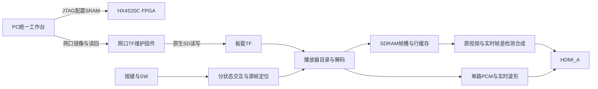

# 架构与源码导读

日常入口只有启动工作台.vbs，启动host/launch_alpha.py，再进入alpha_studio.py。它复用tf_gui界面及protocol/transfers后端。network_transport实现网口会话；device_tools负责TD调用和源码/bit资格检查；alpha_package封装ALPHA100；blackbox_studio、bb48_codec、bc1_codec和media_pipeline负责源视频转码与PCM准备。

播放器顶层为fpga/player/rtl/blackbox_top.v，TD顶层模块名top。source_list.txt、td_project/blackbox.al、build.tcl为构建入口；user_source/constraints_source包含管脚、时钟与FIFO约束。

TF→sd_native4→媒体索引/对象解析→SDRAM压缩帧槽→bb_replay_manager发布当前/三源帧历史→bb_video_cache按行解码→alpha_views合成→官方HDMI/音频底层。alpha_frame_difference实施灰度差与二值内轮廓；bb3_motion_engine实施变化掩膜/区域框；alpha_waveform从媒体PCM生成时间桶与能量，提示音不冒充素材波形。alpha_ui、alpha_keys、alpha_adjust管理分状态按键与开关；alpha_keyframes、alpha_frame_seek、alpha_timeline处理源帧定位及时间带。

网口维护顶层为fpga/tf-maintenance/rtl/top.v：官方RGMII/MAC/UDP→network_bridge包与会话适配→tf_bridge_core命令、CRC、ACK与FIFO→sd_maint4真实SD读写。写后由相同SD控制器读回给PC核对完整SHA。它不含HDMI播放，完成后需要重新加载播放器。

CPU只参与素材准备和维护；播放/分析时不用PC持续发送帧差图或检测坐标。系统不是MP4硬件解码器，也不是神经网络分类器。参考实例底层IP复用边界见来源许可，算法效果限制见版本范围。

冻结的TD源码清单中含若干历史未实例化模块。它们目前作为原生输入哈希的一部分保留，不能机械删除后仍说对应旧bit；本轮未为瘦身重新设计HDL。

上图中的维护与播放是同一FPGA先后加载的两套固件，非同时运行的两个处理器。仅JTAG线不能代替网口/串口传镜像。已有TF兼容资源时，独立播放不需要PC持续处理数据。

发布目录的字体模板由本机生成后恢复为原生输入；本地固件注册只调整路径，不参与视频分析。PC没有持续发送分析结果。
